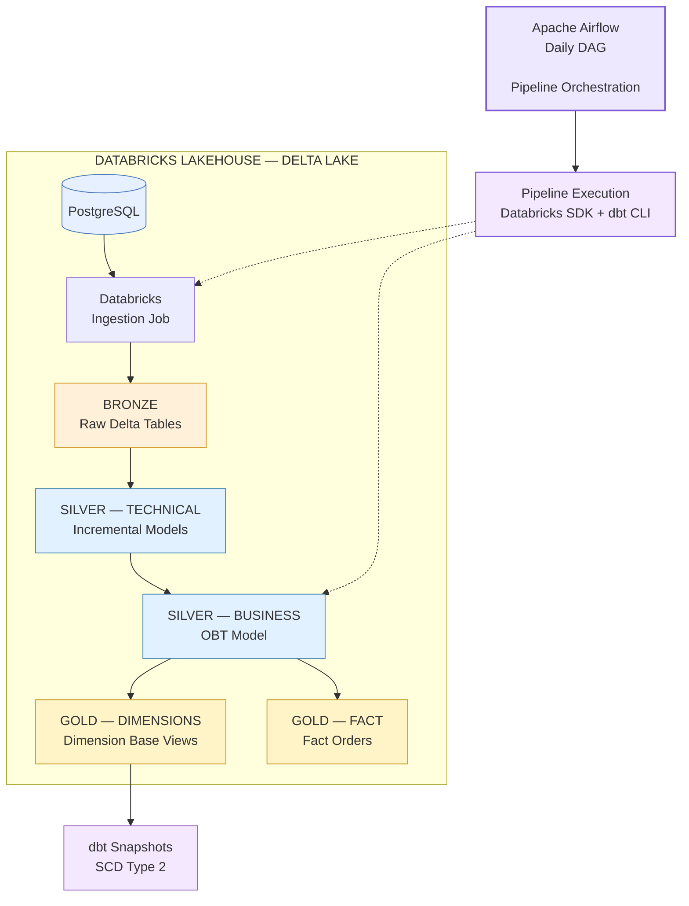

# Walmart Data Engineering Pipeline

A portfolio project demonstrating a Databricks Lakehouse architecture using Apache Airflow and dbt. The project follows the Medallion Architecture (Bronze → Silver → Gold), with Airflow orchestrating ingestion and transformation workflows.

## Architecture

The pipeline uses Apache Airflow as the central orchestrator. It coordinates the Databricks ingestion job and subsequent dbt execution, while Databricks provides the underlying Lakehouse platform for data storage and transformation.



**Orchestration flow:**

1. Apache Airflow runs a scheduled daily DAG.
2. The DAG triggers the Databricks ingestion job through the Databricks SDK and waits for its completion.
3. Airflow executes dbt commands for source freshness, Silver transformations, tests, snapshots and Gold fact creation.
4. dbt compiles the transformations, while Databricks executes the SQL against Delta tables.

> **Execution status:** The original upstream source was a Ghost-hosted PostgreSQL database that is being discontinued. Consequently, the original ingestion path cannot currently be demonstrated end to end. The repository preserves the dbt transformation project and configurable Airflow orchestration implementation. A successful end-to-end execution against a live source is not claimed.

## Technology Stack

| Technology | Purpose |
|---|---|
| Azure Databricks | Lakehouse platform and data processing |
| Delta Lake | Storage format for Bronze, Silver and Gold |
| dbt Core | SQL transformations, testing and snapshots |
| dbt-databricks | dbt integration with Databricks |
| Apache Airflow | Workflow orchestration and scheduling |
| Databricks SDK | Triggering and monitoring Databricks Jobs |
| Docker & Docker Compose | Containerised Airflow environment |
| PostgreSQL | Original upstream data source |

## Repository Structure

```text
walmart-data-engineering-pipeline/
│
├── airflow/
│   ├── dags/
│   │   └── orchestrate.py
│   ├── Dockerfile
│   ├── docker-compose.yml
│   ├── requirements.txt
│   └── .env.example
│
├── dbt/
│   ├── models/
│   │   ├── source/
│   │   ├── silver_t/
│   │   ├── silver_b/
│   │   └── gold/
│   ├── snapshots/
│   ├── macros/
│   ├── tests/
│   ├── dbt_project.yml
│   └── profiles.yml.example
│
├── docs/
│   ├── architecture.md
│   └── github-publishing.md
│
├── .gitignore
└── README.md
```

## Data Transformation Layers

### 1. Bronze Layer — Raw Data Ingestion

- Data is ingested from PostgreSQL into Databricks.
- Source tables are stored as Delta tables.
- The ingestion job is triggered and monitored through the Databricks SDK.

### 2. Silver Layer — Data Transformation

**Silver Technical (`silver_t`)**

- Customer, employee, order, order-item, product and store models.
- Incremental processing using dbt incremental materialisation.
- Merge semantics using configured unique keys.
- Uses `updated_timestamp` as the incremental cursor.

**Silver Business (`silver_b`)**

- Builds a business-level Order Item Wide Table (OBT).
- Combines the technical Silver models using dbt `ref()` dependencies.
- Provides a consolidated dataset for downstream Gold models.

### 3. Gold Layer — Business-Ready Data

**Dimension Models**

- Customer, employee, order, product and store dimension base views.
- These views act as queryable inputs for dbt snapshots.

**Fact Model**

- `fact_orders` is created using the business-level OBT model.

**SCD Type 2 Snapshots**

- Five dbt snapshots are configured for customers, employees, orders, products and stores.
- Uses the timestamp snapshot strategy.
- Tracks historical changes using `dbt_valid_from` and `dbt_valid_to`.

## Airflow Orchestration

Apache Airflow coordinates the pipeline through a daily DAG.

The workflow includes:

1. Triggering and monitoring the Databricks ingestion job.
2. Running dbt source freshness checks.
3. Executing Silver technical transformations.
4. Running Silver technical tests.
5. Executing Silver business transformations.
6. Running Silver business tests.
7. Executing Gold transformations.
8. Running dbt snapshots for SCD Type 2 history.
9. Creating the Gold fact table.

The DAG uses the Databricks SDK to interact with Databricks Jobs and executes dbt commands from a dedicated virtual environment.

## Setup and Execution

### Prerequisites

- Docker Desktop with WSL2 backend.
- A Databricks workspace.
- A running Databricks SQL Warehouse.
- A configured Databricks ingestion Job.
- Required Databricks credentials and permissions.

### Step 1: Configure Airflow

Navigate to the `airflow` directory.

Copy the example environment file:

```bash
cp .env.example .env
```

Configure the required Databricks environment variables, including:

- `DATABRICKS_HOST`
- `DATABRICKS_TOKEN`
- `DATABRICKS_JOB_ID`

Also configure the local Airflow credentials as required by the Compose setup.

### Step 2: Configure dbt

Copy the example profile:

```bash
cp ../dbt/profiles.yml.example ../dbt/profiles.yml
```

Configure the Databricks connection details:

- Workspace host
- SQL Warehouse HTTP path
- Personal access token
- Catalog
- Schema

The Docker setup uses `DBT_PROFILES_DIR` to locate the dbt profile.

### Step 3: Build and Start Services

From the `airflow` directory:

```bash
docker compose up -d --build
```

### Step 4: Access Airflow

Open:

```text
http://localhost:8082
```

Sign in using the local credentials configured for your Airflow environment.

Enable the DAG and trigger a manual run for validation.

The DAG is configured with:

- Schedule: `@daily`
- Catchup: `False`

Ensure that the Databricks ingestion job is valid and populates the Bronze tables expected by the dbt source definitions.

## Important Implementation Details

- **Incremental processing:** Silver models use `updated_timestamp` as their incremental cursor. Late-arriving records and timestamp ties should be validated against the upstream source.
- **Snapshots:** Dimension base models are views rather than ephemeral models because snapshots require queryable relations.
- **Source freshness:** Configure a genuine ingestion/load timestamp in `sources.yml`. A business update timestamp should not automatically be treated as an ingestion timestamp.
- **Data grain:** The Gold order dimension is maintained at order grain, while the business OBT contains order-item-level data.
- **Join cardinality:** The employee join in `obt_b` uses `store_id`. Validate its cardinality to prevent unintended multiplication of order-item records.
- **Orchestration:** Airflow coordinates the Databricks Job and dbt execution, while Databricks performs the actual data processing.

## Validation Status and Limitations

The development environment was built using Docker Compose and Airflow 2.9.3.

The dbt environment was configured with dbt Core and dbt-databricks in an isolated virtual environment. `dbt debug` successfully connected to a running Databricks Starter Warehouse during development.

The final packaged DAG and model refactors have not been executed against a live upstream source. Therefore, the complete pipeline should be validated in a Databricks workspace before being considered production-ready.

The original Ghost PostgreSQL source is no longer available for reliable end-to-end testing.

## Security

Never commit:

- Databricks access tokens.
- Passwords or credentials.
- `.env` files.
- Actual `profiles.yml` files.
- Airflow logs and dbt logs.
- dbt `target/` and `dbt_packages/` directories.

Use the provided example configuration files and supply credentials through your local environment.

**Note:** Any Databricks token previously included in a shared project archive should be revoked and replaced.

---

**Project focus:** Databricks Lakehouse Architecture | Apache Airflow Orchestration | dbt Transformations | Incremental Processing | SCD Type 2 | Docker
