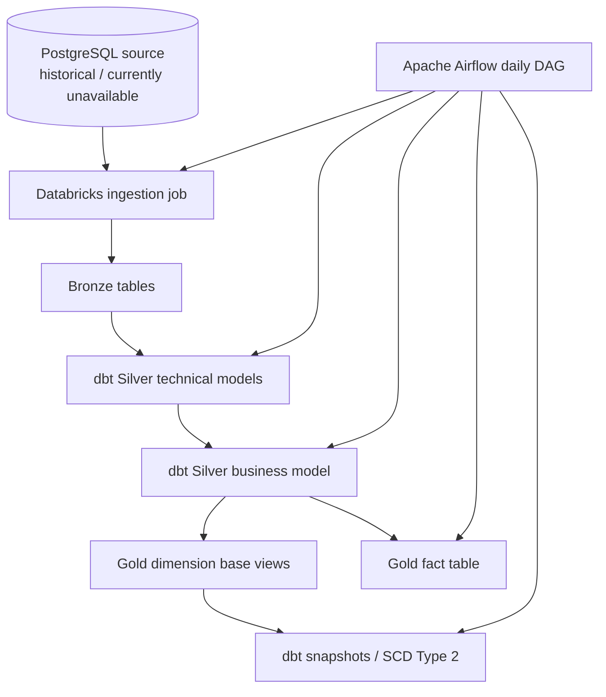

# Walmart Data Engineering Pipeline

A portfolio project demonstrating a Databricks lakehouse transformation workflow orchestrated with Apache Airflow and dbt. The project is organised around a Bronze → Silver → Gold medallion architecture.

> **Execution status and limitation:** The original source was a Ghost-hosted PostgreSQL database. That hosted database is being discontinued, so the original upstream ingestion path cannot currently be demonstrated end to end. The repository preserves the dbt transformation project and a configurable Airflow Databricks-job orchestration pattern. A successful end-to-end run against a live source is not claimed.

## Architecture



The Airflow DAG is scheduled daily. It triggers a configured Databricks Job through the Databricks SDK, waits for its completion, then runs dbt freshness, transformations, tests, snapshots and Gold fact creation. The upstream Databricks Job must populate the Bronze tables expected by `dbt/models/source/sources.yml`.

## Technology stack

- Databricks and Delta Lake (Bronze / Silver / Gold)
- dbt Core and dbt-databricks
- Incremental dbt models using merge semantics
- dbt tests and timestamp-strategy snapshots (SCD Type 2)
- Apache Airflow with a daily DAG and Databricks SDK integration
- Docker Compose with a dedicated dbt virtual environment

## Repository layout

```text
.
├── airflow/
│   ├── dags/orchestrate.py
│   ├── Dockerfile
│   ├── docker-compose.yml
│   ├── requirements.txt
│   └── .env.example
├── dbt/
│   ├── models/
│   ├── snapshots/
│   ├── macros/
│   ├── tests/
│   ├── dbt_project.yml
│   └── profiles.yml.example
└── docs/
```

## Setup

1. Install Docker Desktop with the WSL2 backend.
2. Copy `airflow/.env.example` to `airflow/.env`.
3. Set the Databricks workspace host, personal access token, SQL Warehouse HTTP path, catalog, schema and ingestion Job ID. Never commit `airflow/.env`.
4. Copy `dbt/profiles.yml.example` to `dbt/profiles.yml`. The Docker setup points `DBT_PROFILES_DIR` at `/opt/airflow/dbt`; the actual `profiles.yml` is intentionally excluded from Git.
5. From the `airflow` directory, start the services:

   ```bash
   docker compose up -d --build
   ```

6. Open `http://localhost:8082` and sign in using the local credentials configured in `airflow/.env`. Change the default credentials before exposing the service beyond localhost.
7. In Databricks, ensure the configured ingestion Job is valid and writes the six Bronze source tables listed in `dbt/models/source/sources.yml`.
8. Enable the DAG and trigger a manual run for validation. The DAG is scheduled daily (`@daily`) and has `catchup=False`.

## dbt models

- `silver_t`: customer, employee, order, order-item, product and store incremental models.
- `silver_b`: business-level order-item wide table (`obt_b`), joining the Silver technical models through `ref()`.
- `gold/dimensions`: customer, employee, order, product and store dimension base views. These are views because dbt snapshots need a queryable relation; ephemeral models are not valid physical snapshot inputs. The order base is kept at order grain (not order-item grain).
- `snapshots`: five timestamp-strategy snapshots using each entity's updated timestamp and a current-row `dbt_valid_to` sentinel.
- `gold/fact`: `fact_orders`, sourced from `obt_b`.

## Important configuration notes

- `dbt source freshness` is included in the DAG. Configure a true ingestion/load timestamp and freshness thresholds in `models/source/sources.yml` before relying on freshness results; business `updated_timestamp` should not automatically be treated as ingestion time.
- The incremental filters use `updated_timestamp`. Validate late-arriving records and timestamp ties for your source; for high-reliability CDC, use a stable composite cursor or upstream CDC sequence where available.
- The employee join in `obt_b` is by `store_id`. Validate its cardinality against the intended fact grain to avoid multiplying order-item rows when a store has multiple employees.
- The Databricks ingestion job and credentials are external prerequisites. The repository does not contain credentials or a live Ghost database.

## Validation status

The supplied project history shows that the Airflow environment was built, the DAG imported, dbt was installed in an isolated environment, and `dbt debug` successfully connected to a running Databricks Starter Warehouse. The final DAG and model refactors in this repository have not been executed against a live upstream source in this packaging environment. Validate them in your Databricks workspace before describing the pipeline as fully end-to-end operational.

## Security

Never commit access tokens, passwords, `.env`, `profiles.yml`, Airflow logs, dbt logs, `target/`, `dbt_packages/`, or local state. Rotate any Databricks token that was previously included in a shared archive.
